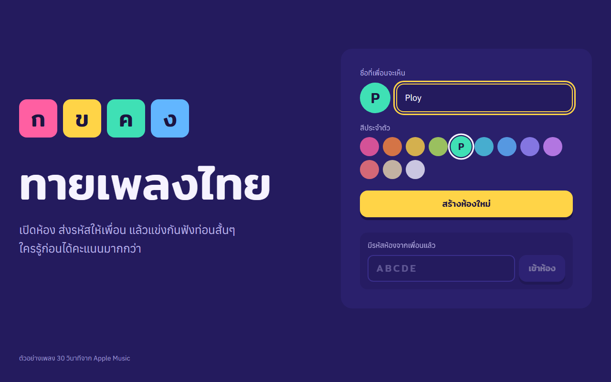
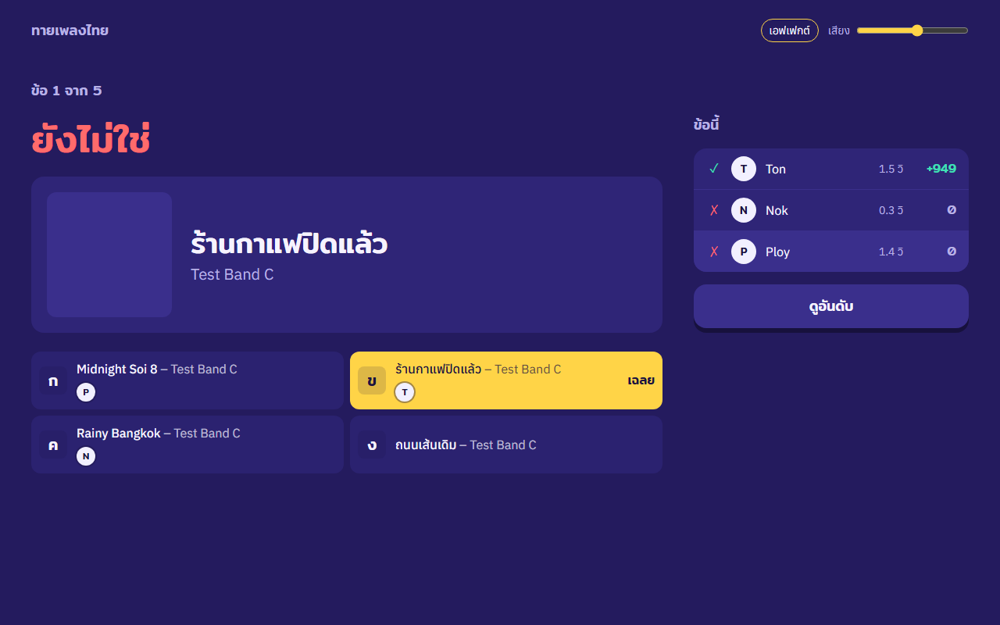
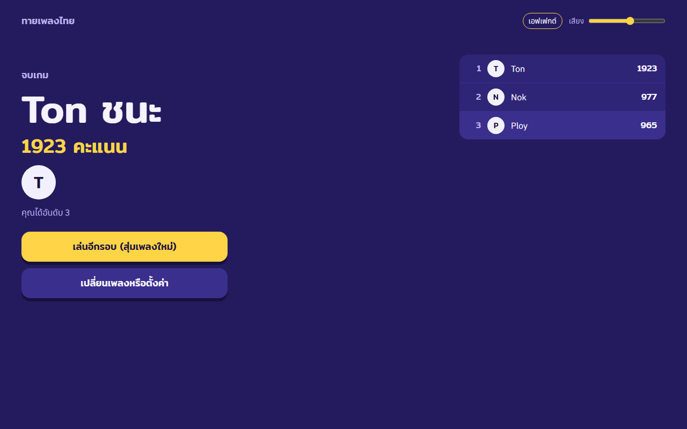
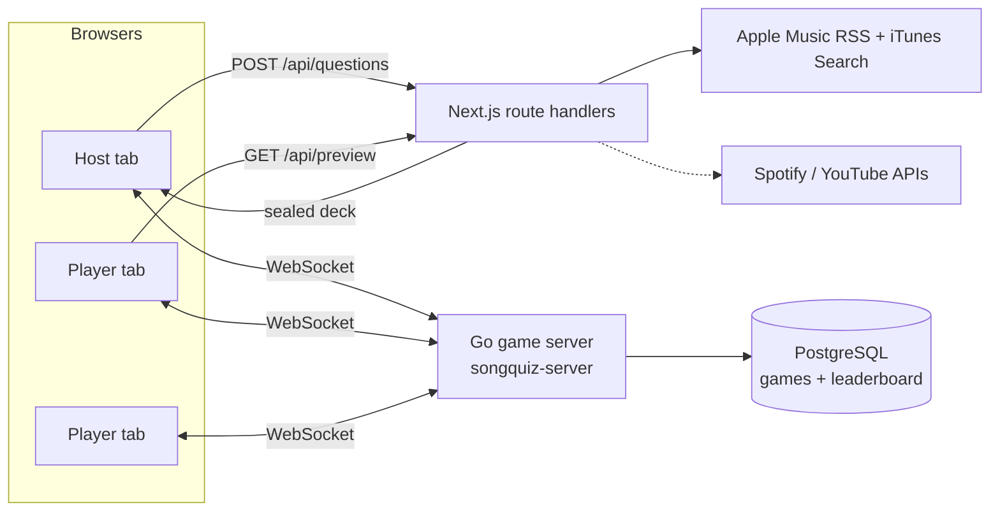

# Thai Song Quiz (ทายเพลงไทย): a real-time multiplayer music quiz

[](https://github.com/bunjonglak123/thai-song-quiz/actions/workflows/ci.yml)

This is a party game I built to play with friends. One person opens a room and shares a
5-letter code. Everyone hears the same 30-second clip of a Thai song at the same moment,
then picks the title from four choices (ก ข ค ง). A faster correct answer scores more
points, and answering correctly several times in a row earns a streak bonus.

**Live:** https://thai-song-quiz-fawn.vercel.app

To try it alone, open the room link in a second browser tab and that tab joins as another player.

| Home | Lobby | Question |
|---|---|---|
|  |  |  |

| Reveal | Final | Mobile |
|---|---|---|
|  |  |  |

*Screenshots are taken from mock mode, so all names and song titles in them are made up.*

## Features

- **Real-time rooms, no accounts.** Players join with a room code or a link. A room holds up to 30 players.
- **Many song sources.** Choose from:
  - Apple Music's Thai Top 100 chart
  - curated sets, such as 2000s rock, 90s pop and heartbreak songs
  - up to 8 artists you pick
  - your own playlist, built by searching Apple Music
  - a Spotify playlist (PKCE login, no client secret needed)
  - a YouTube playlist
- **Hard choices.** Wrong answers are other songs by the same artist when possible, so knowing the singer is not enough. Live, acoustic and karaoke versions and duplicates are filtered out.
- **Synced play.** An optional "listen first" delay (0, 3 or 5 seconds) hides the choices while the clip plays. The answer timer starts when the choices appear, and the round is revealed once everyone has answered or time is up.
- **Survives drop-outs.** The game runs on a Go server, so it keeps going if the host leaves. Host controls move to the next player, and anyone who refreshes within 3 seconds rejoins with their score.
- **Leaderboard.** Best single-game scores this week and all time (games with 2+ players and 5+ questions).
- **Mobile audio that works.** Sound plays through the Web Audio API with a perceptual volume curve, and audio is unlocked on iOS.

## How it works



- **The game runs on a Go server.** [songquiz-server](https://github.com/bunjonglak123/songquiz-server) owns rooms, presence, timers and scoring, one goroutine per room. Browsers send intents (settings, start, answer) and render the state they receive.
- **No browser ever sees an answer.** `/api/questions` builds the questions and seals them with AES-GCM (`src/lib/deck.ts`). The host's browser forwards the sealed deck to the game server, which shares the secret and is the only place it gets opened. That includes the host's own browser.
- **Scoring.** A correct answer is worth 500 points, plus up to 500 more for speed, plus a streak bonus of +100 per round in a row (up to +300).
- **Server routes** (`src/app/api/*`):
  - `questions` builds the sealed question deck.
  - `preview` proxies Apple preview audio (Apple domains only) so Web Audio can decode it.
  - `artists` suggests artist names while you type.
  - `songs` and `youtube` cover the remaining sources.

| File | Role |
|---|---|
| `src/lib/music.ts` | Version filtering, de-duplication, building questions, scoring |
| `src/lib/game-socket.ts` | WebSocket client: reconnect with backoff, wake-up status, optimistic host settings |
| `src/lib/use-room.ts` | React hook around the socket; fetches the deck when the host starts |
| `src/lib/apple.ts` | Thai chart and iTunes search (TH storefront) |
| `src/lib/playlist.ts` | Matching Spotify/YouTube tracks to Apple previews |
| `src/lib/deck.ts` | AES-GCM sealed deck for the game server |
| `src/lib/audio.ts` | Web Audio playback, volume and iOS unlock |

**Stack:** Next.js 16 (App Router), React 19, TypeScript, Tailwind CSS 4, and a Go game server (Gin, WebSocket, PostgreSQL).

## Run it locally

You need Node 22.6 or newer:

```bash
npm install
npm run dev               # http://localhost:3000
```

The game also needs the Go server. Clone [songquiz-server](https://github.com/bunjonglak123/songquiz-server),
run `go run ./cmd/server` there, and start the web app with
`NEXT_PUBLIC_GAME_SERVER_URL=http://localhost:8080 npm run dev`. Open the room in a few tabs
and each tab is a player. No keys are needed; for a fully offline run with made-up songs and
generated tones, add `MOCK_MUSIC=1`.

With Docker:

```bash
docker compose up --build                 # web :3000 + game server :8080 + Postgres
MOCK_MUSIC=1 docker compose up --build    # offline mock songs
```

## Tests

```bash
npm test             # unit tests (node:test): music, playlists, socket client, deck, leaderboard
npm run lint
npm run typecheck
npm run build
npx playwright install chromium
npm run test:e2e     # Playwright against the Go server: full game, host leaves mid-game, leaderboard
npm run screenshots  # regenerate docs/screenshots from mock mode
```

The e2e suite runs the Go server (`SONGQUIZ_SERVER_DIR`, default `../../../songquiz-server`)
on port 8090 and `next start` with `MOCK_MUSIC=1`, so it needs no network or keys. Build with
`NEXT_PUBLIC_GAME_SERVER_URL=http://127.0.0.1:8090` first. The e2e checks that no WebSocket
frame carries an answer while a question is open.

On Windows, Playwright can hang after the run while it shuts the servers down. To avoid
that, start both yourself (`PORT=8090 ALLOWED_ORIGINS=127.0.0.1:3200 go run ./cmd/server` and
`MOCK_MUSIC=1 npx next start -p 3200 -H 127.0.0.1`), then run the tests. Playwright reuses
existing servers outside CI.

## CI/CD

GitHub Actions (`.github/workflows/ci.yml`) runs on every push and pull request:

1. **check:** lint, typecheck, unit tests and a production build.
2. **e2e:** checks out songquiz-server and runs the Playwright tests against that build and the Go server.
3. **secret scan:** fails if any `.env` file is tracked, then runs gitleaks over the full history.

Vercel deploys `main` through its Git integration, and every branch gets a preview deployment.

## Configuration

Set environment variables in Vercel, or in your shell when running locally. No env files
are committed to this repo. Every variable is optional.

| Variable | Used for |
|---|---|
| `NEXT_PUBLIC_GAME_SERVER_URL` | Where browsers reach the Go game server (required, baked in at build time) |
| `NEXT_PUBLIC_SPOTIFY_CLIENT_ID` | Turns on the Spotify playlist source. The redirect URI is `/spotify-callback` |
| `YOUTUBE_API_KEY` | Turns on the YouTube playlist source (server-side only) |
| `DECK_SECRET` | Key that seals the question deck. Must match the game server. Set it in production |
| `MOCK_MUSIC` | `1` uses made-up songs and generated tones (tests and offline use) |

Spotify apps in Development Mode can read only playlists the logged-in user owns or
collaborates on, and only the host needs to log in.

## Known limitations

- Answer times are measured on each player's device, so a determined player can cheat.
  The game is meant for friends, not prize contests.
- The iTunes Search API is rate-limited (about 20 requests per minute per IP). Results are
  cached for an hour. When the limit is hit, some wrong answers fall back to songs by other artists.
- Spotify and YouTube tracks must be matched to Apple Music previews. Tracks that Apple
  Music Thailand doesn't have are skipped, and the lobby shows a warning.
- The game server runs on Render's free plan, which sleeps when idle. The first visit after a
  quiet spell takes about 30 seconds to wake it; the home page starts waking it as soon as it loads.
- Preview clips belong to Apple and are used under its promotional terms. The reveal screen links to the full song on Apple Music.
