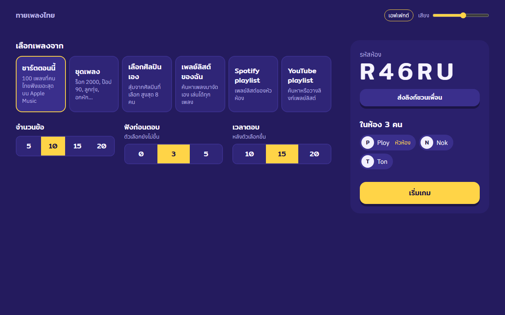
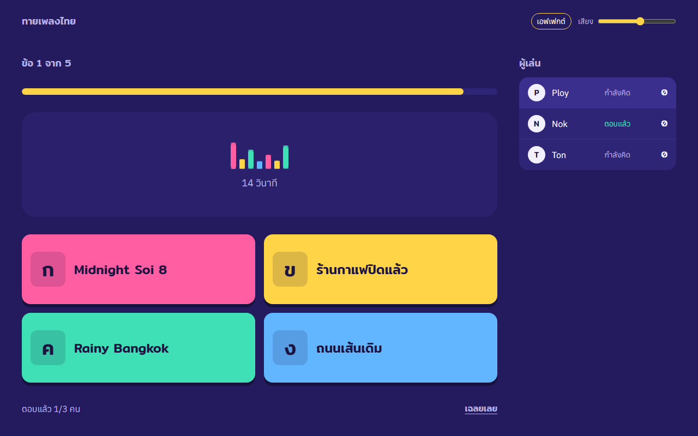
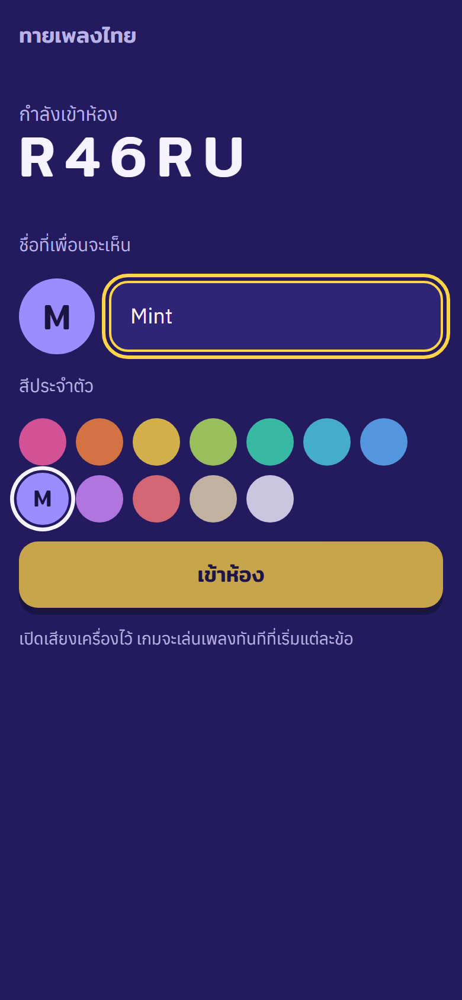
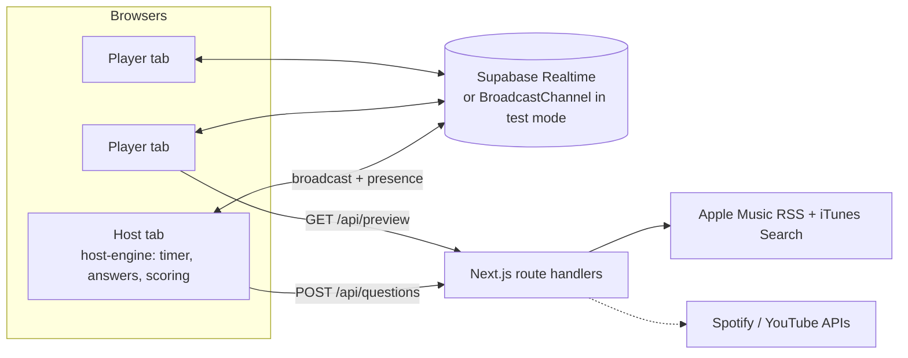

# Thai Song Quiz (ทายเพลงไทย): a real-time multiplayer music quiz

[](https://github.com/bunjonglak123/thai-song-quiz/actions/workflows/ci.yml)

This is a party game I built to play with friends. One person opens a room and shares a
5-letter code. Everyone hears the same 30-second clip of a Thai song at the same moment,
then picks the title from four choices (ก ข ค ง). A faster correct answer scores more
points, and answering correctly several times in a row earns a streak bonus.

**Live:** https://thai-song-quiz-fawn.vercel.app

To try it alone, open the room link in a second browser tab and that tab joins as another player.

| Home | Lobby | Question |
|---|---|---|
|  |  |  |

| Reveal | Final | Mobile |
|---|---|---|
|  |  |  |

*Screenshots are taken from mock mode, so all names and song titles in them are made up.*

## Features

- **Real-time rooms, no accounts.** Players join with a room code or a link. A room holds up to 30 players.
- **Many song sources.** Choose from:
  - Apple Music's Thai Top 100 chart
  - curated sets, such as 2000s rock, 90s pop and heartbreak songs
  - up to 8 artists you pick
  - your own playlist, built by searching Apple Music
  - a Spotify playlist (PKCE login, no client secret needed)
  - a YouTube playlist
- **Hard choices.** Wrong answers are other songs by the same artist when possible, so knowing the singer is not enough. Live, acoustic and karaoke versions and duplicates are filtered out.
- **Synced play.** An optional "listen first" delay (0, 3 or 5 seconds) hides the choices while the clip plays. The answer timer starts when the choices appear, and the round is revealed once everyone has answered or time is up.
- **Host failover.** If the host disconnects for more than 6 seconds, the next player becomes host automatically. The game continues with the same songs and scores.
- **Mobile audio that works.** Sound plays through the Web Audio API with a perceptual volume curve, and audio is unlocked on iOS.

## How it works



- **No database.** All game state lives in the host's browser and is broadcast over a realtime channel. With Supabase, the channel uses broadcast and presence. Without Supabase, the game falls back to `BroadcastChannel`, so several tabs in one browser can play together. Tests, Docker and the e2e run all use this fallback.
- **The host is the referee.** `src/lib/host-engine.ts` runs the game loop: it starts each round, collects answers, keeps the clock, reveals the answer and computes scores. Players only receive what they need to see. The answer key is never sent to players.
- **Failover without leaking answers.** The question deck is encrypted with AES-GCM on the server (`src/lib/deck.ts`) and every player holds the encrypted copy. When a new host takes over, it sends that copy to `/api/deck`, the only place it can be decrypted, so the game continues from the same question.
- **Scoring.** A correct answer is worth 500 points, plus up to 500 more for speed, plus a streak bonus of +100 per round in a row (up to +300).
- **Server routes** (`src/app/api/*`):
  - `questions` builds the question set.
  - `preview` proxies Apple preview audio (Apple domains only) so Web Audio can decode it.
  - `artists` suggests artist names while you type.
  - `songs`, `youtube` and `deck` cover the remaining sources and failover.

| File | Role |
|---|---|
| `src/lib/music.ts` | Version filtering, de-duplication, building questions, scoring |
| `src/lib/host-engine.ts` | Host game loop (unit-tested with an injected clock) |
| `src/lib/room.ts` | Room controller: joining, host election, batching realtime messages |
| `src/lib/transport.ts` | Realtime transport: Supabase or BroadcastChannel |
| `src/lib/apple.ts` | Thai chart and iTunes search (TH storefront) |
| `src/lib/playlist.ts` | Matching Spotify/YouTube tracks to Apple previews |
| `src/lib/deck.ts` | AES-GCM encrypted deck for host failover |
| `src/lib/audio.ts` | Web Audio playback, volume and iOS unlock |

**Stack:** Next.js 16 (App Router), React 19, TypeScript, Tailwind CSS 4, Supabase Realtime.

## Run it locally

You need Node 22.6 or newer:

```bash
npm install
npm run dev               # http://localhost:3000
```

No keys are needed. Without Supabase the game runs in multi-tab mode: open the room in a
few tabs and each tab is a player. Songs still come from Apple Music previews. For a
fully offline run with made-up songs and generated tones, start it with `MOCK_MUSIC=1 npm run dev`.

With Docker:

```bash
docker compose up --build                 # http://localhost:3000
MOCK_MUSIC=1 docker compose up --build    # offline mock songs
```

## Tests

```bash
npm test             # 50 unit and integration tests (node:test): music, scoring, host engine, rooms, failover
npm run lint
npm run typecheck
npm run build
npx playwright install chromium
npm run test:e2e     # Playwright: two players play a full 5-round game to the final screen
npm run screenshots  # regenerate docs/screenshots from mock mode
```

The e2e suite runs against `next start` with `MOCK_MUSIC=1` and no Supabase, so it needs
no network or keys. The Playwright config starts the server itself.

On Windows, Playwright can hang after the run while it shuts down the server. To avoid
that, start the server yourself (`MOCK_MUSIC=1 npx next start -p 3200 -H 127.0.0.1`) and
then run the tests. Playwright reuses an existing server outside CI.

## CI/CD

GitHub Actions (`.github/workflows/ci.yml`) runs on every push and pull request:

1. **check:** lint, typecheck, unit tests and a production build.
2. **e2e:** the Playwright tests against that build.
3. **secret scan:** fails if any `.env` file is tracked, then runs gitleaks over the full history.

Vercel deploys `main` through its Git integration, and every branch gets a preview deployment.

## Configuration

Set environment variables in Vercel, or in your shell when running locally. No env files
are committed to this repo. Every variable is optional.

| Variable | Used for |
|---|---|
| `NEXT_PUBLIC_SUPABASE_URL` | Supabase project URL. If empty, the game uses multi-tab test mode |
| `NEXT_PUBLIC_SUPABASE_PUBLISHABLE_KEY` | Supabase publishable key (or `NEXT_PUBLIC_SUPABASE_ANON_KEY` for legacy keys) |
| `NEXT_PUBLIC_SPOTIFY_CLIENT_ID` | Turns on the Spotify playlist source. The redirect URI is `/spotify-callback` |
| `YOUTUBE_API_KEY` | Turns on the YouTube playlist source (server-side only) |
| `DECK_SECRET` | Key used to encrypt the failover deck. Set it in production |
| `MOCK_MUSIC` | `1` uses made-up songs and generated tones (tests and offline use) |

Supabase needs no tables, only Realtime. Make sure "private channels only" is turned off.
Spotify apps in Development Mode can read only playlists the logged-in user owns or
collaborates on, and only the host needs to log in.

## Known limitations

- Answer times are measured on each player's device, so a determined player can cheat.
  The game is meant for friends, not prize contests.
- The iTunes Search API is rate-limited (about 20 requests per minute per IP). Results are
  cached for an hour. When the limit is hit, some wrong answers fall back to songs by other artists.
- Spotify and YouTube tracks must be matched to Apple Music previews. Tracks that Apple
  Music Thailand doesn't have are skipped, and the lobby shows a warning.
- If the host drops mid-round, that round restarts under the new host.
- Preview clips belong to Apple and are used under its promotional terms. The reveal screen links to the full song on Apple Music.
